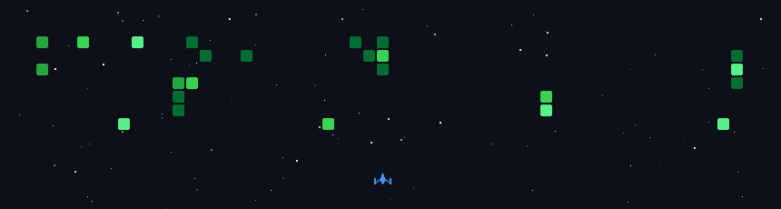

<h1 align="center">
  Hey, I'm Akasha
</h1>

<h3 align="center">
  🎓 Third-Year Computer Systems Engineering Undergraduate
</h3>

  <i>Embedded Systems · Digital Electronics · Hardware Engineering</i>

  

  ⚡ Design · Develop · Debug · Repeat

---

## 👩‍💻 About Me

- 🎓 Third-year Computer Systems Engineering undergraduate at SLIIT, Sri Lanka.
- 🔌 Interested in embedded systems, microcontrollers and digital circuit design.
- ⚙️ Exploring hardware-software integration, IoT and robotics.
- 🛠️ Enjoy developing practical engineering prototypes and solving technical problems.
- 🌱 Continuously strengthening my knowledge of electronics, control systems and computer architecture.

## 🧠 Technical Focus Areas

  
  
  
  
  

## 🛠️ Languages & Tools

### 💻 Programming Languages

  &nbsp;&nbsp;
  &nbsp;&nbsp;
  &nbsp;&nbsp;
  &nbsp;&nbsp;
  

### 🔧 Hardware & Development Tools

  

  <i>Working with ESP32, AVR Assembly, Proteus, EasyEDA and microcontroller-based systems.</i>

---

## 🚀 Engineering Projects

### ☀️ Portable Solar-Powered Fuel Quality Screening System

An ESP32-based prototype designed to screen fuel samples for abnormal properties using sensor measurements.

**Technologies:** ESP32 · Sensors · Embedded Systems · Solar Power

### 🔆 Solar Tracking System

A closed-loop tracking system using light sensors and a DC motor with encoder feedback to support position control using PID.

**Technologies:** Embedded Control · PID · Motor Control · Sensors

### 💡 Digital Pattern Detection System

A digital logic system combining a pseudo-random sequence generator, PISO shift register and Mealy finite-state machine to detect a specified binary pattern.

**Technologies:** Digital Logic · Finite-State Machines · Shift Registers · Proteus

  

---

## 🎮 GitHub Contributions

  

  <i>Turning contribution history into a space adventure — one commit at a time.</i>

---

## 📈 Most Used Languages

  

---

## 🌐 Connect With Me

  &nbsp;&nbsp;
  &nbsp;&nbsp;
  

  <i>Building at the intersection of hardware and software.</i>

  Thanks for visiting my GitHub profile.

